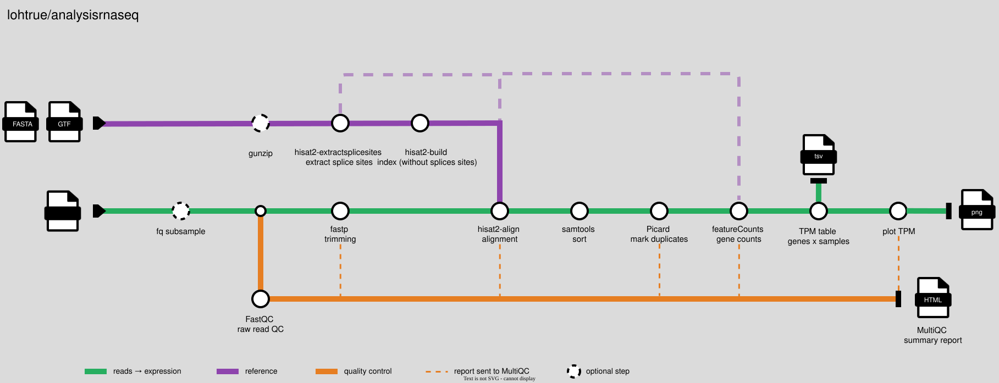

# lohtrue/analysisrnaseq

## Introduction

**lohtrue/analysisrnaseq** is a lightweight RNA-seq pipeline designed for educational purposes, focusing on memory efficiency, fast runtime and reproducibility, so that it runs on standard laptops. The   pipeline takes a sample sheet of single- or paired-end FASTQ files, a reference genome (FASTA) and a gene annotation (GTF) as input. It performs subsampling (optional), quality control, trimming, alignment to a reference genome, duplicate marking and gene level quantification. As an output it gives back a TPM expression table, TPM plots for visualization and a MultiQC report.





## Pipeline steps

1. Subsampling of reads - optional ([`fastp`](https://nf-co.re/modules/fq_subsample))
2. Read quality control ([`FastQC`](https://nf-co.re/modules/FastQC/))
3. Adapter/quality trimming ([`fastp`](https://nf-co.re/modules/fastp/))
4. Decompression of reference files - if gzipped ([`gunzip`](https://nf-co.re/modules/gunzip/))
5. Extraction of splice sites([`HISAT2_extractsplicesites`](https://nf-co.re/modules/hisat2_extractsplicesites/))
6. Building index for reference genome ([`HISAT2_build`](https://nf-co.re/modules/hisat2_build/))
7. Alignment to the reference genome ([`HISAT2_align`](https://nf-co.re/modules/hisat2_align/))
8. Sorting of alignments ([`SAMtools_sort`](https://nf-co.re/modules/samtools_sort/))
9. Duplicate marking ([`Picard_markduplicates`](https://nf-co.re/modules/picard_markduplicates/))
10. Gene-level read counting ([`featureCounts`](https://nf-co.re/modules/subread_featurecounts))
11. Transcripts per Million (TPM) expression table (genes × samples) ([`tpm_table`](modules/local/tpm_table/main.nf))
12. Potting TPM values ([`local/plot_tpm`](modules/local/plot_tpm/main.nf))
13. Summary report ([`MultiQC`](https://nf-co.re/modules/multiqc/))


## Usage

> [!NOTE]
> If you are new to Nextflow and nf-core, please refer to [this page](https://nf-co.re/docs/get_started/environment_setup/overview) on how to set-up Nextflow. Make sure to [test your setup](https://nf-co.re/docs/get_started/run-your-first-pipeline) with `-profile test` before running the workflow on actual data.


First, prepare a samplesheet with your input data that looks as follows:

`samplesheet.csv`:

```csv
sample,fastq_1,fastq_2, strandedness
CONTROL_REP1,AEG588A1_S1_L002_R1_001.fastq.gz,AEG588A1_S1_L002_R2_001.fastq.gz, reverse
TREATED_REP1,TREATED_REP1_R1.fastq.gz,,reverse
```

Each row represents one sample. A sample can be single-end (one fastq file, `fastq_2` empty) or paired end (pair of fastq files). The column `strandedness` describes the library type and must be `forward`, `reverse` or `unstranded`.


Now, you can run the pipeline using:

```bash
nextflow run lohtrue/analysisrnaseq \
   -profile docker \
   --input samplesheet.csv \
   --fasta genome.fa \
   --gtf genes.gtf \
   --outdir <OUTDIR>
```

For more details and further functionality / (e.g. subsampling, resource limits), please refer to the [usage documentation](docs/usage.md).

> [!WARNING]
> Please provide pipeline parameters via the CLI or Nextflow `-params-file` option. Custom config files including those provided by the `-c` Nextflow option can be used to provide any configuration _**except for parameters**_; see [docs](https://nf-co.re/docs/running/run-pipelines#using-parameter-files).

## Credits

lohtrue/analysisrnaseq was originally written by Hanna Lohmann, Pia Truebenbach.


## Contributions and Support

If you would like to contribute to this pipeline, please see the [contributing guidelines](docs/CONTRIBUTING.md).

## Citations

<!-- TODO nf-core: Add citation for pipeline after first release. Uncomment lines below and update Zenodo doi and badge at the top of this file. -->
<!-- If you use lohtrue/analysisrnaseq for your analysis, please cite it using the following doi: [10.5281/zenodo.XXXXXX](https://doi.org/10.5281/zenodo.XXXXXX) -->

<!-- TODO nf-core: Add bibliography of tools and data used in your pipeline -->

An extensive list of references for the tools used by the pipeline can be found in the [`CITATIONS.md`](CITATIONS.md) file.

This pipeline uses code and infrastructure developed and maintained by the [nf-core](https://nf-co.re) community, reused here under the [MIT license](https://github.com/nf-core/tools/blob/main/LICENSE).

> **The nf-core framework for community-curated bioinformatics pipelines.**
>
> Philip Ewels, Alexander Peltzer, Sven Fillinger, Harshil Patel, Johannes Alneberg, Andreas Wilm, Maxime Ulysse Garcia, Paolo Di Tommaso & Sven Nahnsen.
>
> _Nat Biotechnol._ 2020 Feb 13. doi: [10.1038/s41587-020-0439-x](https://dx.doi.org/10.1038/s41587-020-0439-x).
